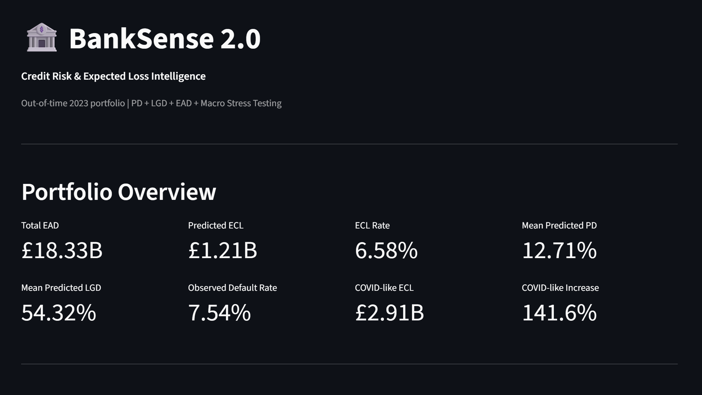
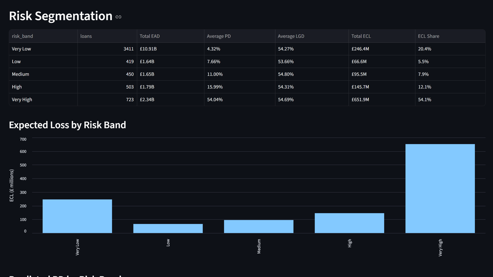
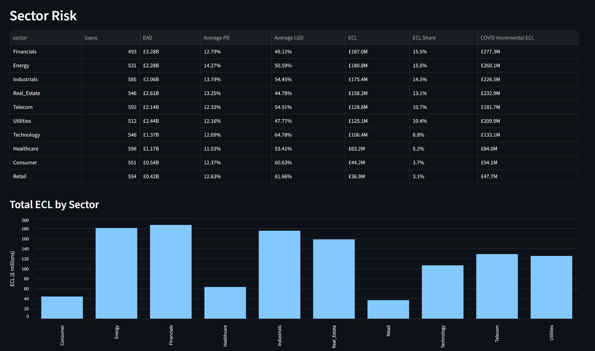
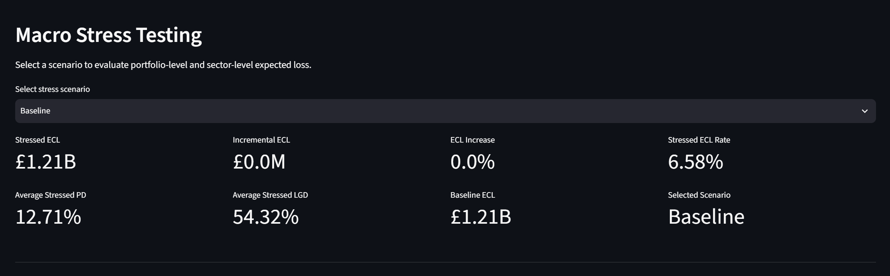
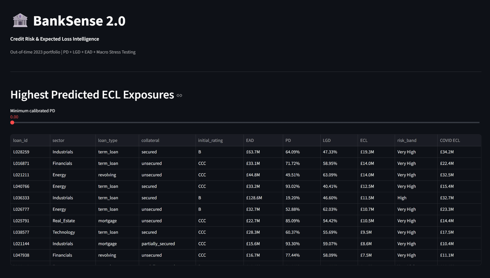

# BankSense 2.0 — Credit Risk, ECL & Macro Stress Testing

**BankSense 2.0** is an end-to-end credit-risk analytics portfolio project built on a public 50,000-loan dataset. It combines Python-based PD/LGD modelling, probability calibration, expected credit loss (ECL), macro stress testing, a Streamlit dashboard, automated output checks, and Microsoft SQL Server analytics.

> **Scope:** This is an independent portfolio demonstration using public dataset records. It is not an IDBI Bank project, does not use confidential bank data, and is not a production credit-decisioning or regulatory reporting system.

## What the project demonstrates

- Data audit, cleaning, data-quality checks, and feature-timing/leakage review.
- Chronological model development rather than relying only on a random train/test split.
- Probability of Default (PD) modelling with Logistic Regression and a Gradient Boosting challenger.
- Platt and isotonic calibration comparison using a development-period design.
- Loss Given Default (LGD) modelling on defaulted loans using `HistGradientBoostingRegressor`.
- Loan-level ECL calculations using `PD × LGD × EAD`.
- Six macro stress scenarios and sector-level loss analysis.
- Interactive Streamlit portfolio and loan-level dashboard.
- Microsoft SQL Server tables, Python-to-SQL data loading, analytical T-SQL queries, and data-quality checks.
- Seven automated data-contract tests for exported model outputs.

## Current 2023 out-of-time portfolio snapshot

The latest local run was regenerated after fitting preprocessing on the training split only. The figures below reflect the refreshed outputs observed in the SQL Server reconciliation.

| Metric | Latest result |
|---|---:|
| Test loans | **5,506** |
| Total Exposure at Default (EAD) | **£18.332B** |
| Observed default rate | **7.5372%** |
| Mean calibrated PD | **12.7292%** |
| Mean predicted LGD | **54.3245%** |
| Predicted ECL | **£1.207539B** |
| ECL / total EAD | **6.5870%** |
| COVID-like stressed ECL | **£2.916532B** |
| COVID-like incremental ECL | **£1.708993B** |
| COVID-like ECL increase vs baseline | **141.53%** |

The Python output summary and SQL Server aggregate reconciliation differ only by tiny floating-point/decimal rounding amounts (less than £0.001 for the monetary comparisons shown). The six exported output files were loaded to SQL Server, and their expected row counts were confirmed.

## PD modelling and calibration methodology

The PD workflow uses an origination-time feature set and chronological splits:

```text
2015–2020  → Train the base model and fit preprocessing
2021       → Fit calibration candidates
2022       → Compare calibration candidates and select the method
2023       → Final out-of-time evaluation
```

Preprocessing is fitted on the training split only, then applied to the other splits. Candidate models and calibration methods are compared on development data before the 2023 results are reported. The 2023 cohort is not used to retune model parameters or validation-derived risk-band thresholds.

Calibration method comparison on the 2022 evaluation period:

| Method | Brier score (lower is better) | ROC-AUC | Mean predicted PD | Observed default rate |
|---|---:|---:|---:|---:|
| Raw Logistic Regression | 0.065979 | 0.873515 | 17.5423% | 8.0775% |
| **Platt calibration** | **0.058034** | **0.873515** | **10.7421%** | 8.0775% |
| Isotonic calibration | 0.059264 | 0.872875 | 11.5569% | 8.0775% |

Platt calibration achieved the lowest Brier score in this comparison while preserving the raw model's ROC-AUC. This improves probability quality on the 2022 evaluation period, but does not eliminate the calibration gap in 2023. Re-run the notebook to regenerate run-specific final-test metrics after any modelling or preprocessing change.

## Out-of-time calibration findings

The fixed probability-bucket analysis of the 2023 test population shows that observed default rates generally increase as predicted PD rises. However, predicted probabilities remain higher than the observed rates, especially in the upper-risk tail.

| Predicted PD bucket | Loans | Defaults | Mean predicted PD | Observed default rate | Calibration gap (percentage points) |
|---|---:|---:|---:|---:|---:|
| 0–5% | 2,591 | 15 | 3.87% | 0.58% | 3.29 |
| 5–10% | 1,340 | 40 | 6.63% | 2.99% | 3.65 |
| 10–15% | 551 | 55 | 12.34% | 9.98% | 2.36 |
| 15–20% | 263 | 36 | 17.02% | 13.69% | 3.34 |
| 20–30% | 173 | 28 | 24.16% | 16.18% | 7.97 |
| 30–50% | 151 | 44 | 38.46% | 29.14% | 9.32 |
| 50–100% | 437 | 197 | 68.44% | 45.08% | 23.36 |

The largest calibration gap occurs in the 50–100% predicted-PD bucket. This is documented as residual probability-calibration error and potential temporal instability. It is not “fixed” by changing cutoffs after observing the final test set.

### Validation-derived risk bands

Risk-band thresholds are computed from calibrated PD scores in the 2021–2022 validation period and applied unchanged to the 2023 out-of-time test data. The bands are therefore not forced to contain equal numbers of 2023 loans.

| Risk band | Loans | Defaults | Mean calibrated PD | Observed default rate |
|---|---:|---:|---:|---:|
| Very Low | 157 | 1 | 2.77% | 0.64% |
| Low | 565 | 2 | 3.23% | 0.35% |
| Medium | 1,574 | 9 | 4.03% | 0.57% |
| High | 1,507 | 31 | 6.05% | 2.06% |
| Very High | 1,703 | 372 | 30.75% | 21.84% |

The first three bands are not monotonic by observed default rate. They contain only 1, 2, and 9 defaults, respectively, so their observed rates are sensitive to a small number of events. The Very High band shows a clear concentration of defaults. This is retained as a model-risk finding; thresholds are not retuned on the 2023 test data.

## LGD modelling

LGD is modelled on defaulted loans using `HistGradientBoostingRegressor` and compared with a mean-LGD baseline. The notebook reports MAE, RMSE, and R² across validation and out-of-time test populations. Predicted LGD values are constrained to the valid `[0, 1]` range before ECL calculation.

Because LGD targets are available only for defaulted loans, LGD results should be interpreted separately from PD performance. This model is a demonstration of an LGD workflow, not a production recovery model.

## ECL and macro stress testing

The portfolio-level calculation is:

```text
Expected Credit Loss = Probability of Default × Loss Given Default × Exposure at Default
ECL                  = PD × LGD × EAD
```

Six scenarios are included:

- Baseline
- Mild
- Adverse
- GFC-like
- Severe
- COVID-like

Updated SQL Server stress-summary outputs:

| Scenario | Stressed ECL | Increase vs baseline |
|---|---:|---:|
| Baseline | £1.208B | 0.00% |
| Mild | £1.484B | 22.86% |
| Adverse | £1.868B | 54.70% |
| GFC-like | £2.209B | 82.93% |
| Severe | £2.401B | 98.83% |
| COVID-like | £2.917B | 141.53% |

Stress multipliers are an independently constructed analytical demonstration. They are not calibrated regulatory stress parameters and should not be treated as IFRS 9 expected credit loss estimates.

## Sector analysis

Sector summaries compare exposure, average PD, average LGD, expected loss, and incremental stressed ECL. One portfolio insight is that the sector with the largest absolute incremental loss does not have to be the sector with the highest loss intensity per unit of exposure. Use both total contribution and ECL per £1 million of EAD when reviewing concentration and intensity.

## Streamlit dashboard

The dashboard provides:

- Executive portfolio KPIs
- Risk-band analysis
- Sector-level credit-risk analysis
- Six-scenario stress testing
- Loan-level risk and ECL views
- High-risk exposure filtering

### Executive overview



### Risk segmentation



### Sector risk



### Macro stress testing



### Loan-level risk



## Run locally

### Prerequisites

- Python 3.12+
- [`uv`](https://docs.astral.sh/uv/)
- VS Code/Jupyter support for notebook execution
- Streamlit dependencies declared in `pyproject.toml`

From the project root:

```powershell
uv sync
uv run streamlit run dashboard/app.py
```

Open `http://localhost:8501` in a browser.

To rerun the analytical workflow, execute the notebooks in order:

1. `notebooks/01_data_audit.ipynb`
2. `notebooks/02_data_cleaning.ipynb`
3. `notebooks/03_leakage_analysis.ipynb`

The modelling notebook writes refreshed CSVs to `data/model_outputs/`. Run the output tests and CSV checks after regenerating outputs.

## Automated output tests

The repository includes seven data-contract tests for model outputs. They check unique loan IDs, required fields, probability ranges, ECL arithmetic, stress-scenario completeness, baseline stress consistency, and dashboard output contracts.

Run from the project root:

```powershell
uv run python -m unittest discover -s tests -v
```

The seven tests passed in the latest reported local run. These are software/data-contract checks; they do not replace independent statistical validation of the models.

## Microsoft SQL Server integration

The project includes T-SQL scripts under `sql/sql_server/`. The verified local workflow used SQL Server Express, SSMS, Windows Authentication, and Microsoft ODBC Driver 18.

### Create the database and tables

In SSMS, connect to your SQL Server instance and execute these scripts in order:

1. `sql/sql_server/01_create_database.sql`
2. `sql/sql_server/02_create_schema_and_tables.sql`

The database is `BankSense`; target tables are in the `banksense` schema.

### Configure and validate the Python loader

Install the loader dependency if it is not already in the project environment:

```powershell
uv add --dev pyodbc
```

Set the connection string for the current PowerShell session. Replace the server value with the exact instance shown in SSMS:

```powershell
$env:BANKSENSE_SQLSERVER_CONNECTION_STRING = 'DRIVER={ODBC Driver 18 for SQL Server};SERVER=localhost\SQLEXPRESS;DATABASE=BankSense;Trusted_Connection=yes;TrustServerCertificate=yes;'
```

Validate the CSV schemas before connecting:

```powershell
uv run python sql/sql_server/load_outputs.py --check-only
```

Load the six model-output CSVs:

```powershell
uv run python sql/sql_server/load_outputs.py
```

**Important:** the loader deletes and reloads records in the six `banksense` output tables within a single transaction. Use it only with the portfolio database. Do not point it at a production or shared database. Keep server credentials and passwords out of source control.

### SQL analytics and quality checks

In SSMS, execute:

- `sql/sql_server/03_analytics_queries.sql` — portfolio summary, risk-band metrics, sector contribution, stress scenarios, and review queue.
- `sql/sql_server/04_data_quality_checks.sql` — row counts, probability-range checks, ECL arithmetic checks, and scenario inventory.

The six loaded tables and their verified row counts in the latest local run are:

| Table | Rows |
|---|---:|
| `banksense.loan_risk_output` | 5,506 |
| `banksense.stress_ecl_loan_level` | 33,036 |
| `banksense.stress_summary` | 6 |
| `banksense.sector_dashboard` | 10 |
| `banksense.risk_band_dashboard` | 5 |
| `banksense.portfolio_dashboard_summary` | 10 |

A separate `sql/postgresql/` folder is also included as an alternative SQL implementation. The documented tested workflow above uses Microsoft SQL Server.

## Data source and attribution

The project uses the public Kaggle dataset **Credit Risk Dataset — 50k Loans, 10 Sectors**, created by **Sergey Nefedov**:

- Source: https://www.kaggle.com/datasets/sergionefedov/credit-risk-dataset-50k-loans-10-sectors
- Dataset license stated in the source record: MIT License
- Provenance and license notice: [`data/raw/SOURCE_AND_LICENSE.txt`](data/raw/SOURCE_AND_LICENSE.txt)

The original dataset creator remains the dataset author. This repository's notebooks, modelling workflow, SQL integration, tests, and dashboard are the portfolio implementation built around the attributed dataset.

## Repository structure

```text
Bank_sense_2.0/
├── data/
│   ├── raw/
│   ├── processed/
│   └── model_outputs/
├── dashboard/
│   └── app.py
├── docs/
│   └── screenshots/
├── notebooks/
│   ├── 01_data_audit.ipynb
│   ├── 02_data_cleaning.ipynb
│   └── 03_leakage_analysis.ipynb
├── sql/
│   ├── postgresql/
│   └── sql_server/
├── src/
│   └── bank_sense_2_0/
├── tests/
│   └── test_model_outputs.py
├── AUDIT_REPORT.md
├── pyproject.toml
├── uv.lock
├── .python-version
└── README.md
```

## Limitations and model-risk disclosures

- The dataset is synthetic/public demonstration data, not confidential customer or bank data.
- The observed default prevalence falls from training to validation and 2023 test; this temporal change affects absolute PD calibration.
- Even after Platt calibration, mean predicted PD exceeds the observed 2023 default rate. The fixed-bin analysis also shows larger gaps in the upper predicted-risk buckets.
- Validation-derived risk bands are not monotonic by observed default rate in the first three 2023 bands. The low number of defaults in those bands makes rates unstable, and thresholds were not retuned on the final test set.
- LGD is evaluated conditionally on default.
- ECL is a simplified `PD × LGD × EAD` demonstration, not a full IFRS 9 implementation: accounting staging, discounted expected cash flows, lifetime-PD term structures, and institution-specific production assumptions are not implemented.
- Macro stress multipliers are illustrative and not regulatory calibration.
- Model coefficients and feature effects describe conditional associations, not causal relationships.
- Automated tests validate data contracts and arithmetic; they are not a substitute for independent model validation, governance, monitoring, or regulatory review.

## Key takeaway

BankSense 2.0 demonstrates a workflow from data quality and feature governance through temporal PD modelling, calibration comparison, LGD modelling, ECL, stress testing, dashboard delivery, and SQL Server analytics. It also documents weaknesses instead of tuning them away on the final test set—an important part of responsible credit-risk analysis.

## Author

**Ashwani Kumar Tripathi**

*BankSense 2.0 — Credit Risk & Expected Loss Analytics*
